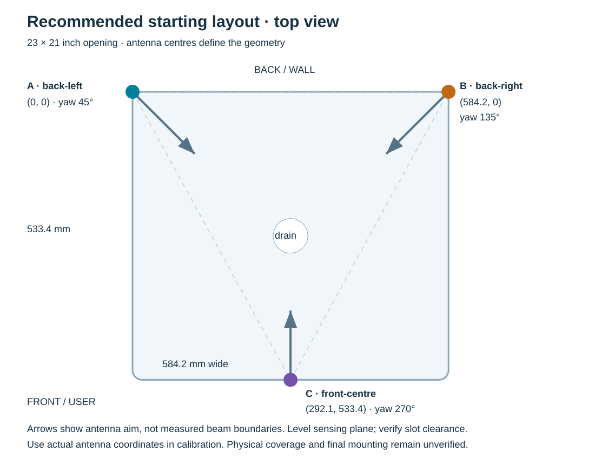
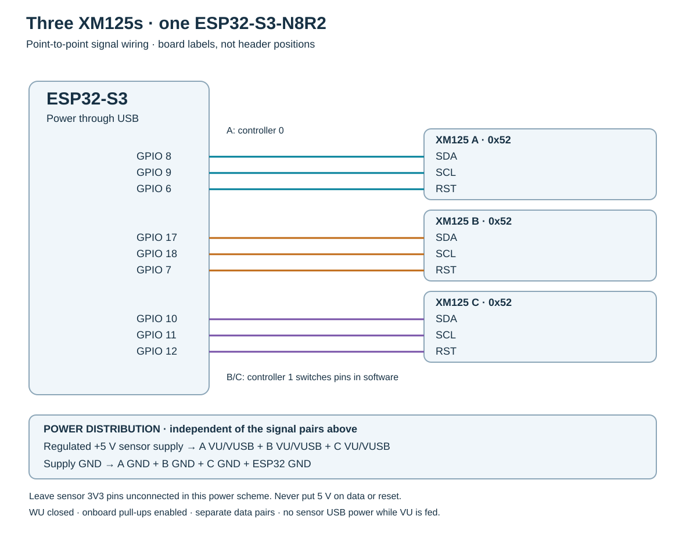

# Three-sensor installation

**Build:** three SparkFun Qwiic XM125 breakouts, one ESP32-S3-N8R2. Nominal opening 23 × 21 in (584.2 × 533.4 mm). Hidden sensors look through the gap beneath the countertop. This is a proposed, bench-unverified installation for the LED/interface proof of concept.

## Placement

Viewed from the user, put A back-left, B back-right and C front-left. Each antenna centre is **2 inches (50.8 mm) diagonally outside its opening corner**: 1.414 inches (35.92 mm) along each axis, not 2 inches along each axis. Use adjustable mounts and the angles below. This is the selected bench layout; the ideal horizontal 65° sector model gives about 71% all-three overlap, not 100% coverage or a measured detection rate. See the [placement comparison](placement-comparison.md).

| Sensor | Antenna centre x | Antenna centre y | Starting yaw | Tilt / z |
|---|---:|---:|---:|---:|
| A — back-left | −35.92 mm | −35.92 mm | 43° | 0° / 0 mm |
| B — back-right | 620.12 mm | −35.92 mm | 129° | 0° / 0 mm |
| C — front-left | −35.92 mm | 569.32 mm | 323° | 0° / 0 mm |

**Existing devices:** firmware updates preserve saved calibration. In Studio C1 keep the opening at 584.2 × 533.4 mm; in C2 enter the actual A/B/C antenna coordinates; in C3 enter yaw and tilt. Set the model's horizontal half-angle to 32.5° and vertical half-angle to 26.5° only when the wider antenna plane is horizontal. In Aim, enter measured recess and slot height; 50.8 mm recess and 14 mm slot are provisional factory modelling values. Re-run empty-sink and hand calibration after moving sensors or changing the cover. Export the old calibration before editing; do not erase all settings just to change the mount.

Origin is the nominal back-left opening corner; x goes right, y goes toward the user. Yaw is measured from +x toward +y. Values locate the radar antenna, not the PCB corner or mounting screw. If the antenna sits outside this nominal rectangle, enter its actual coordinates; do not move the coordinate origin to hide a setback. The opening dimensions and antenna baseline are not necessarily equal.

Mount each antenna face toward the intended sensing area: radiation leaves the face of the antenna package, approximately normal to its plane. Laying a board flat under the counter with its antenna pointing upward will not produce the horizontal arrangement drawn here. The SparkFun PCB is roughly 25.4 × 50.8 mm; verify that the board and required orientation actually fit the slot. If the slot cannot accommodate this, the mechanical mount must change before calibration.

Use adjustable, nonmetallic supports. Use a replaceable, controlled-thickness radar window before permanent resin encapsulation. Optical clarity does not establish radar transparency. The material, thickness, antenna spacing and wet surface must be tested together. A straight window perpendicular to the beam, 50.8 mm from the antenna, needs roughly 64.7 mm clear horizontal width to avoid clipping a 65° fan; a continuous radar-transparent wall differs from a narrow opaque tunnel. Keep the antenna's view clear of the metal sink lip, fasteners and foil-backed trim; place it as close to the slot mouth as the enclosure and splash protection permit. Keep all three sensing planes level initially. Do not assume radar sees through the metal sink or stone countertop. A radome, countertop overhang or deep recess changes the result and needs testing in its final position. Record actual slot height, antenna recess and z offset. No unmeasured numeric clearance is guaranteed here.

A third range improves geometric conditioning when all sensors see the same target; it does not guarantee full coverage. Each sensor can miss adjacent edge regions with a narrow installed beam, or have its view blocked by the user's hand/arm. The 60 mm minimum detector range also creates local exclusion regions. The UI beam widths are adjustable modelling assumptions, not measured installed antenna specifications. Plan for a tested working area inside the opening and exclude unreliable cells.

## Wiring

| ESP32 GPIO | XM125 destination | Purpose |
|---:|---|---|
| 8 | A SDA | data |
| 9 | A SCL | clock |
| 6 | A RST | independent reset |
| 17 | B SDA | data |
| 18 | B SCL | clock |
| 7 | B RST | independent reset |
| 10 | C SDA | data |
| 11 | C SCL | clock |
| 12 | C RST | independent reset |
| GND | A GND, B GND, C GND, supply negative | common signal reference |

**Recommended power arrangement in the drawing:** power the ESP32 through its normal USB port. Supply the three XM125 boards from one regulated 5 V sensor supply connected separately to each board's **VU/VUSB** input and GND. A 5 V / 1 A supply is a starting engineering allowance for the three sensor boards only; confirm voltage and peak current under calibration. Each SparkFun board uses its onboard regulator. Leave the XM125 3V3 pins and the ESP32 3V3 pin unconnected to each other in this arrangement. Do not simultaneously connect a sensor's USB power and the external VU feed. Disconnect external power and GPIO connections when flashing that sensor by USB.

The alternative is a verified clean 3.3 V supply into each module's 3V3 input, but that is a different power scheme. Do not inject 5 V into 3V3, SDA, SCL or RST. Do not assume an unspecified ESP32 development-board regulator can power all three sensor boards reliably.

Keep three distinct SDA/SCL pairs. Do not daisy-chain the XM125 Qwiic connectors: each module answers at 0x52, and the documented ADDR selector is not implemented. A uses controller 0. B and C share controller 1 in software, with pins disconnected/reassigned before their transactions; the wires themselves are not joined. No external I²C multiplexer is needed for this implementation. Physical reset lines also remain separate.

Leave each sensor's WU jumper closed and its onboard I²C pull-ups enabled. There is one module per physical pair, so its existing 2.2 kΩ pull-ups serve that pair. INT, UART and BOOT pins are not needed in normal operation. Reset GPIOs operate open-drain: low resets, release allows the board's pull-up to restore high. Start with short routed cables and common ground alongside signals; try 100 kHz if bus errors appear, and verify all three after changing speed.

Keep sensor wiring away from LED power wiring. If using the existing LED ring, retain GPIO4 → 74AHCT125 → series resistor → LED DIN, its appropriately sized separate 5 V power supply and common ground. The sensor supply budget above does not include the LED ring. No mains, valve, heater or disposal wiring is included in this proof of concept.

## What the software now does

1. Initialise, reset, configure and read A, B and C sequentially. B/C controller remapping happens before each transaction, including health and calibration reads.
2. Filter each module's echo list, consider triples, and fit x/y by least squares using the configured hand depth. Require a noncollinear sensor triangle, a consistent third range, a fix inside the opening and no dead-area mask. The residual rejection limit is 35 mm, an initial tunable-in-code engineering threshold requiring bench validation.
3. Require all three sensors for a new acquisition. During an existing track, a healthy module may reuse echoes for at most two frames; all-held data cannot establish a fix. A disconnected module invalidates its hold. This is not an immediate actuator emergency-stop design: the existing session exit/disposal timing still applies to the demonstration state machine.
4. Include C in frame and health messages, hardware checks, backgrounds, calibration capture, geometry fitting and live echo displays. The legacy A–B spacing/clutter diagnostic remains a pair-based aid and is not the three-sensor position acceptance test.
5. Use configuration schema 2. Loading schema 1 enables C while retaining measured geometry. Confirm the opening, C position and all offsets in Studio; do not treat a migrated two-sensor calibration as commissioned. Back up the old configuration and keep a rollback firmware/UI pair.

Three coplanar range sensors do not resolve signed vertical hand position. The solver uses `hand.zwork`; depth errors and different reflection points on a real hand can bias x/y. Sequential acquisition also adds motion skew. Compile success cannot establish scan rate, interference rejection or real-hand accuracy. Firmware and UI must be deployed together.

## Commissioning and choosing the final position

Keep the scene dry and use the LED demo first. Record the firmware commit, module detector versions, power arrangement, cable lengths, slot dimensions, actual antenna coordinates and photographs in [issue #5](https://github.com/lorops-stack/artesian-ring-poc/issues/5).

1. Flash the same supported I²C distance-detector firmware onto all three XM125s. Boot the ESP32 with an empty opening. Check that A/B/C each answer, configure, measure and reset independently. Disconnect C and verify that it is reported missing and cannot start a new session. Reconnect and recheck.
2. At the drain and each intended zone, move a calibration target and then a real hand. Inspect each raw echo list separately. Confirm all three see the target before interpreting the fused point. Measure actual full-triplet frame rate, bus errors and power voltage during reset/calibration.
3. Measure and enter geometry, record the empty-scene background, then run C7 at all 16 template holes and both prescribed depths. For the flat mount these are 10 and 50 mm below the sensing plane. Use a fixture whose dimensions and ball radius match the calibration settings. C8 uses 5/35 mm hand positions for the flat mount. Reject incomplete/poor fits; retain held-out errors as well as training RMS.
4. Repeat fixed-grid and boundary runs with real hands, different hand orientations, two hands, a torso at the front, towels, dishes and the final countertop/radome. Include all sensor-adjacent near zones and the unoccupied front-right corner. Measure accepted triples, missed detections, wrong-zone selections, latency and false sessions during an empty-scene soak. Report denominators and raw logs, not just a percentage.
5. Compare the recommended front-left C with the mirrored front-right corner and front-centre (292.1, 533.4), yaw 270°. Re-measure and recalibrate for each candidate, keeping power, A/B and test sequence constant. Choose the layout with the best verified intended-zone coverage and lowest wrong-zone/false-session rate, then latency and maintainability. Do not optimise only range RMS.
6. Mark blind regions and adjust zones/masks accordingly. If all-three coverage is inadequate, change the physical mount or sensing architecture in a new issue rather than silently enabling a two-sensor fallback. Record approval and remaining limitations before any release or appliance integration.

## Access and maintenance

The WPA2 access-point password is the access boundary for both browser WebSocket commands and HTTP controls. There is no second operator PIN in this build. Share that password only with people who may change the configuration; anyone connected can control this bench demo. OTA remains disabled by default. Calibration uses bounded polling with watchdog progress and releases the shared state lock during long detector operations.

## Sources and scope

The attached R10 package provides product/demo context; it does not supply measured three-sensor installation evidence. Existing main-branch code and the separate hardening branch were reviewed together. Open work, decisions and validation remain in [epic #2](https://github.com/lorops-stack/artesian-ring-poc/issues/2) and its linked issues.

- [SparkFun hardware overview](https://docs.sparkfun.com/SparkFun_Qwiic_Pulsed_Radar_Sensor_XM125/hardware_overview/): power inputs, logic levels, jumpers, reset and board dimensions.
- [Espressif I²C API](https://docs.espressif.com/projects/arduino-esp32/en/latest/api/i2c.html): controller end/begin and pin assignment.
- [Acconeer radome and mechanical design](https://docs.acconeer.com/en/latest/hw_integration/a121/radome_and_mechanical_design.html): enclosure-dependent antenna patterns and reference measurement of radome range offsets. Do not transplant a spacing dimension from one dielectric/shape to an untested countertop slot.
- [Acconeer distance detector](https://docs.acconeer.com/en/latest/detectors/a121/distance_detector.html): detector operation and constraints.

Placement and supply sizing are engineering recommendations for this prototype, not manufacturer guarantees or measured acceptance results.
